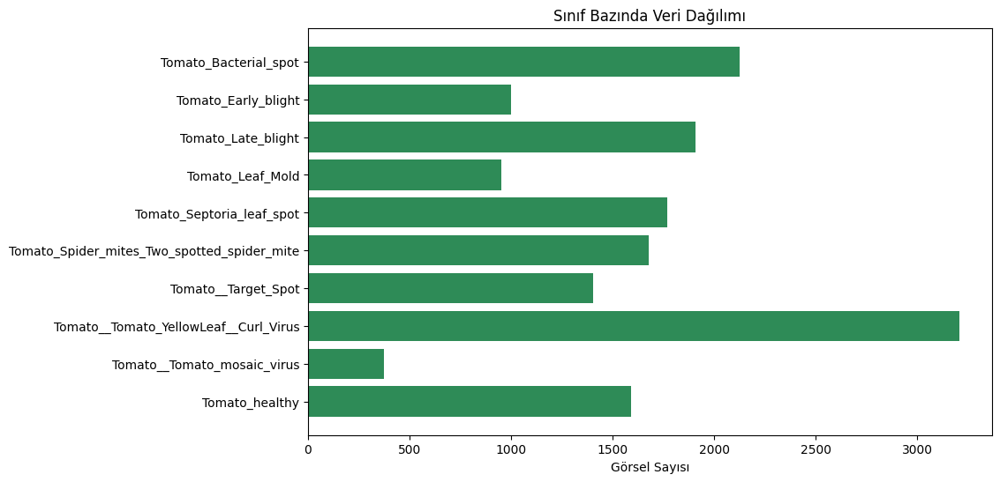
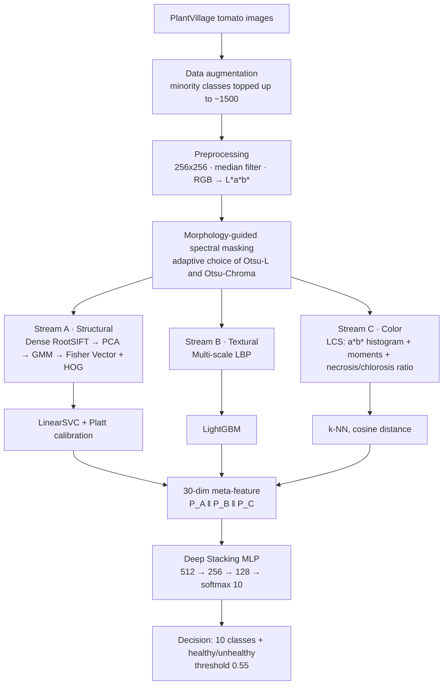
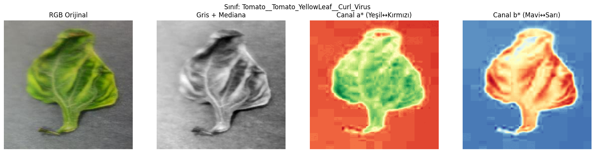
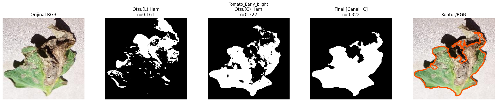
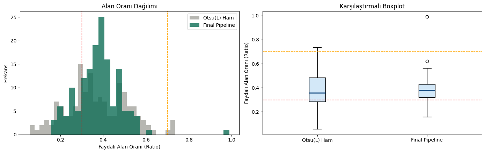
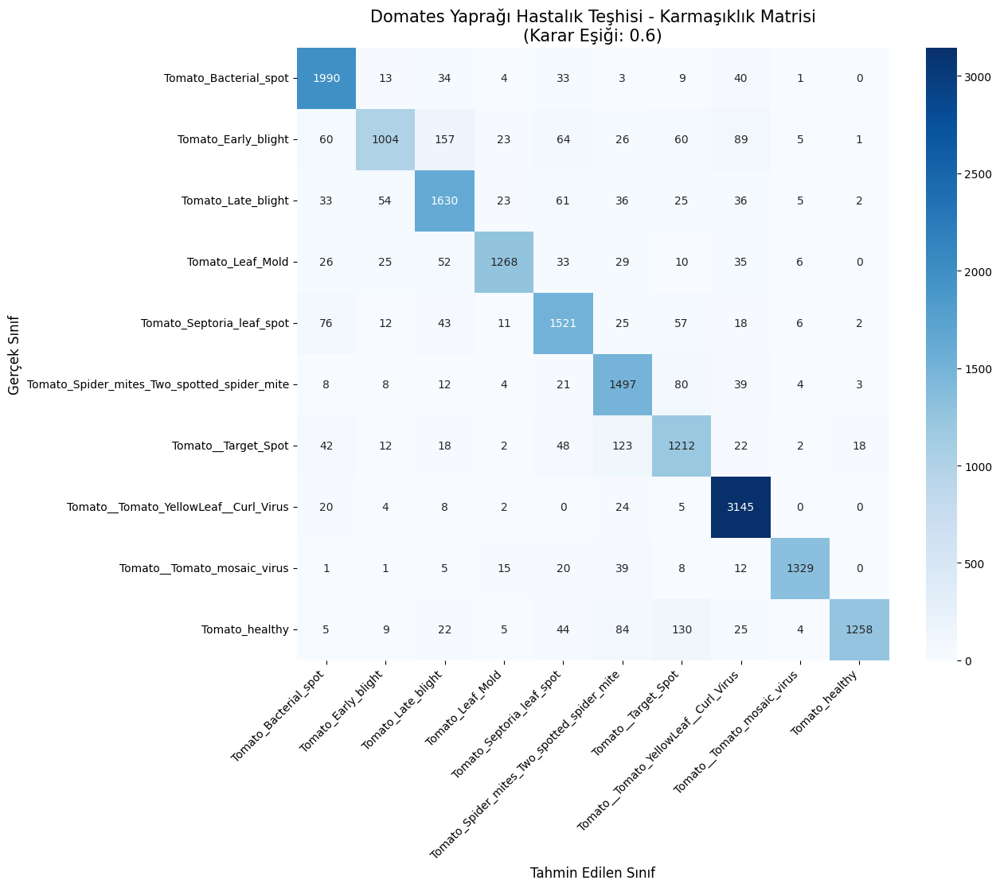
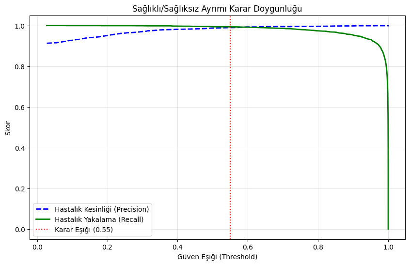

# 🍅 Tomato Leaf Disease Detection

**Morphology-Guided Spectral Masking and Multi-Stream Feature Fusion Architecture**

A hybrid image processing and machine learning system that classifies the **10 tomato leaf classes** (9 diseases + healthy) in the PlantVillage dataset without using deep convolutional networks (CNNs). Biological prior knowledge (green / red-brown / yellow tissue colors, lesion texture and shape) is embedded directly into feature extraction, so what each stream "sees" remains interpretable.

| Metric | Value |
|---|---|
| 10-class accuracy (20% hold-out, 3,635 images) | **91.25%** (macro F1: 0.9052) |
| 10-class accuracy (5-fold cross-validation, weighted fusion) | 87.23% (macro F1: 0.8639) |
| Healthy / unhealthy (binary) accuracy | **98.79%** |
| Average inference time | ~404 ms / image (≈ 2.5 FPS, Google Colab) |

---

## Table of Contents

1. [Classes and Dataset](#classes-and-dataset)
2. [Method and Pipeline](#method-and-pipeline)
3. [Technologies Used](#technologies-used)
4. [Installation](#installation)
5. [Outputs and Results](#outputs-and-results)
6. [Repository Structure](#repository-structure)


---

## Classes and Dataset

Dataset: [PlantVillage (Kaggle – `emmarex/plantdisease`)](https://www.kaggle.com/datasets/emmarex/plantdisease). Only the tomato folders are kept (16,011 images in the original).

| ID | Class | ID | Class |
|---|---|---|---|
| 0 | Bacterial spot | 5 | Spider mites (two-spotted spider mite) |
| 1 | Early blight | 6 | Target spot |
| 2 | Late blight | 7 | Yellow Leaf Curl Virus |
| 3 | Leaf mold | 8 | Mosaic virus |
| 4 | Septoria leaf spot | 9 | Healthy |

To reduce class imbalance, under-represented classes (Early blight, Leaf mold, Target spot, Mosaic virus) were augmented with `ImageDataGenerator` up to roughly 1,500 images each → **18,184 images**. After segmentation, 9 images (leaf area too large) were discarded, leaving **18,175 images** in use.




---

## Method and Pipeline



### 1. Preprocessing
- Images are resized to **256×256** (`INTER_AREA`).
- A **3×3 median filter** is applied to the grayscale copy (removes salt-and-pepper noise while preserving lesion edges).
- RGB → **L\*a\*b\*** conversion: the a\* channel carries green↔red information (healthy tissue ↔ diseased tissue), and the b\* channel carries blue↔yellow information (yellowing).



### 2. Morphology-Guided Spectral Masking (Segmentation)
- Four methods are compared: global threshold (T=100), Otsu (brightness), Otsu (chroma = √(a\*²+b\*²)), and Multi-Otsu.
- The final method is **adaptive**: Otsu-L and Otsu-Chroma masks are generated separately and cleaned with morphological **opening (3×3) → closing (5×5, 2 iterations) → hole filling → largest connected component**.
- Of the two masks, the channel whose leaf area ratio falls within the valid range (0.10–0.90) and is closer to the target ratio (0.38) is selected.
- Images with an area ratio < 0.05 or > 0.95 are discarded.




### 3. Three-Stream Feature Extraction (from the masked leaf region only)

| Stream | Feature | Dimension | What it captures |
|---|---|---|---|
| **A – Structural** | Dense **RootSIFT → PCA(64) → GMM(32) → Fisher Vector** + **pyramidal HOG** (256 and 128 px, Hellinger norm.) | 4096 + 9864 = 13,960 | Lesion shape, edge orientation |
| **B – Textural** | **Multi-scale LBP** ((P,R) = (8,1), (16,2), (24,3), uniform) | 54 | Micro-texture, roughness |
| **C – Color** | **LCS (Lesion Color Signature)**: 16×16 a\*b\* histogram, moments (mean, std, skewness), necrotic and chlorotic tissue ratios | 264 | Disease-specific color signature |


### 4. Expert Classifiers (Stage 1)
- **Stream A → LinearSVC** (C=1) + 5-fold **Platt (sigmoid) calibration** to produce probabilities
- **Stream B → LightGBM** (63 leaves, 300 trees, learning rate 0.05, `class_weight='balanced'`)
- **Stream C → k-NN** (cosine distance, distance-weighted; k ∈ {3, 5, 7} selected by macro F1 using 3-fold inner CV within each outer fold)
- Predictions are produced as *out-of-fold* predictions via **5-fold stratified cross-validation**.

### 5. Meta-Decision Layer (Stage 2 – Deep Stacking)
- The 10-class probability vectors from the three streams are concatenated to form a **30-dimensional meta-feature**.
- **MLP**: Dense(512, Swish, L2=1e-4) + BN + Dropout(0.5) → Dense(256, Swish, L2=1e-4) + BN + Dropout(0.4) → Dense(128, ReLU) + BN → Softmax(10)
- Adam (lr=0.001), up to 200 epochs, batch size 32, `EarlyStopping(patience=20)` and `ReduceLROnPlateau(factor=0.2)`.
- Data is split 80% / 20% (stratified); a **0.55 decision threshold** is applied for the "healthy" class.

---

## Technologies Used

| Area | Tools |
|---|---|
| Language / environment | Python 3, Jupyter Notebook, Google Colab |
| Image processing | OpenCV (`cv2`), scikit-image (LBP, HOG, Multi-Otsu, color spaces), SciPy (`ndimage`) |
| Classical machine learning | scikit-learn (LinearSVC, CalibratedClassifierCV, k-NN, PCA, GaussianMixture, StratifiedKFold), LightGBM |
| Deep learning (meta-layer only) | TensorFlow / Keras (MLP) |
| Data / visualization | NumPy, pandas, Matplotlib, seaborn, tqdm |
| Data source | Kaggle API (PlantVillage) |

---

## Installation

> The project was developed on Google Colab. The paths in the notebook (`/content/plant_data`, `/content/outputs`) are Colab-specific.

### Option 1 — Google Colab (easiest)
1. Upload the `tomato_leaf_diseases.ipynb` file to [Google Colab](https://colab.research.google.com/) (or open it from GitHub).
2. From your Kaggle account, go to **Settings → API → Create New Token**, download `kaggle.json`, and upload it to the Colab session.
3. Run the cells in order (the first cells download and extract the dataset).

### Option 2 — Local installation

```bash
# 1) Clone the repository
git clone https://github.com/<username>/<repo-name>.git
cd <repo-name>

# 2) Create a virtual environment
python -m venv .venv
source .venv/bin/activate        # Windows: .venv\Scripts\activate

# 3) Install dependencies
pip install -r requirements.txt

# 4) Place the Kaggle API key (kaggle.json)
mkdir -p ~/.kaggle && cp kaggle.json ~/.kaggle/ && chmod 600 ~/.kaggle/kaggle.json

# 5) Download and extract the dataset
kaggle datasets download -d emmarex/plantdisease
unzip -q plantdisease.zip -d ./plant_data && rm plantdisease.zip

# 6) Open the notebook
jupyter notebook tomato_leaf_diseases.ipynb
```

When running locally, update the following paths in the notebook to match your own directory:

```python
DATASET_ROOT = "./plant_data/PlantVillage"
OUTPUT_DIR   = "./outputs"
```

Also replace the sample images `tar.jfif` / `tar4.jfif` in the last cells of the notebook with your own test image.

**Execution order:** data download → keeping only the tomato folders → data augmentation → preprocessing and segmentation → mask generation (`dataset_contract.npy`) → feature extraction (LBP, HOG, LCS, Fisher Vector) → expert models and 5-fold CV → ablation → MLP stacking → evaluation and speed measurement.

---

## Outputs and Results

### Segmentation validation (150 random images)
- Mean leaf area ratio: **0.379 ± 0.105** (raw Otsu-L: 0.372 ± 0.141) — the adaptive method noticeably reduces variance.
- Proportion of masks within the target range [0.20 – 0.70]: **143 / 150 (95.3%)**
- Channel selected across the whole dataset: Chroma 11,265, Brightness (L) 6,892, fallback 18



### Ablation study (5-fold CV, weighted fusion: 0.4 / 0.3 / 0.3)

| Model | Accuracy | F1-Macro |
|---|---|---|
| Stream A: FV + HOG → LinearSVC (structural) | 0.8363 | 0.8246 |
| Stream B: LBP → LightGBM (textural) | 0.7186 | 0.7039 |
| Stream C: LCS → k-NN (color) | 0.6909 | 0.6782 |
| **Hybrid fusion (A+B+C)** | **0.8723** | **0.8639** |

Fusion gain over the best single stream: **+3.60 points**. Accuracy per fold: 0.8801 · 0.8704 · 0.8696 · 0.8677 · 0.8737.



### Deep Stacking (MLP) — 10-class result (hold-out, n = 3,635)

**Accuracy: 91.25% · Macro F1: 0.9052 · Weighted F1: 0.9121**

| Class | Precision | Recall | F1 | Support |
|---|---|---|---|---|
| Bacterial spot | 0.9465 | 0.9153 | 0.9306 | 425 |
| Early blight | 0.8598 | 0.7819 | 0.8190 | 298 |
| Late blight | 0.8953 | 0.8976 | 0.8965 | 381 |
| Leaf mold | 0.9126 | 0.9495 | 0.9307 | 297 |
| Septoria leaf spot | 0.8603 | 0.8701 | 0.8652 | 354 |
| Spider mites | 0.8941 | 0.9075 | 0.9007 | 335 |
| Target spot | 0.8339 | 0.8367 | 0.8353 | 300 |
| Yellow Leaf Curl Virus | 0.9652 | 0.9922 | 0.9785 | 642 |
| Mosaic virus | 0.9650 | 0.9650 | 0.9650 | 286 |
| Healthy | 0.9306 | 0.9306 | 0.9306 | 317 |


### Healthy / Unhealthy (binary) classification

| Class | Precision | Recall | F1 | Support |
|---|---|---|---|---|
| Healthy | 0.9306 | 0.9306 | 0.9306 | 317 |
| Unhealthy | 0.9934 | 0.9934 | 0.9934 | 3,318 |

**Overall accuracy: 98.79%**




### Example predictions


### Speed / efficiency
Over 100 images, the average time from raw image to final decision is **404.06 ms ± 94.41 ms** (≈ **2.47 FPS**); the time measured for a single image is 0.3455 s.

### Error analysis
For samples that are "healthy" but misclassified, errors shift mainly toward the *Target spot*, *Septoria leaf spot*, and *Spider mites* classes; the decisions of the three streams can be examined in tabular form in the last cell of the notebook.

---

## Repository Structure

```
.
├── tomato_leaf_diseases.ipynb   # Entire pipeline (data → segmentation → features → model → evaluation)
├── requirements.txt             # Python dependencies
├── images/                      # Figures taken from notebook outputs
└── README.md
```

---


