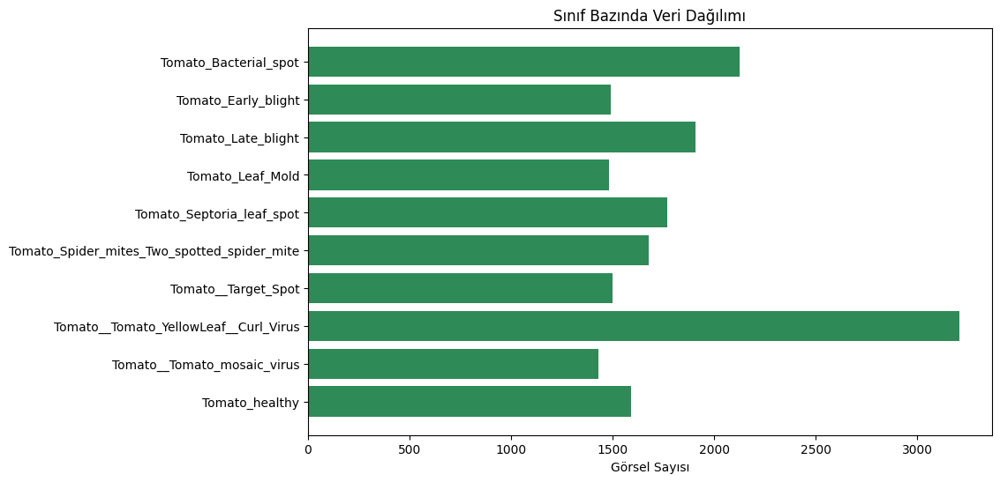
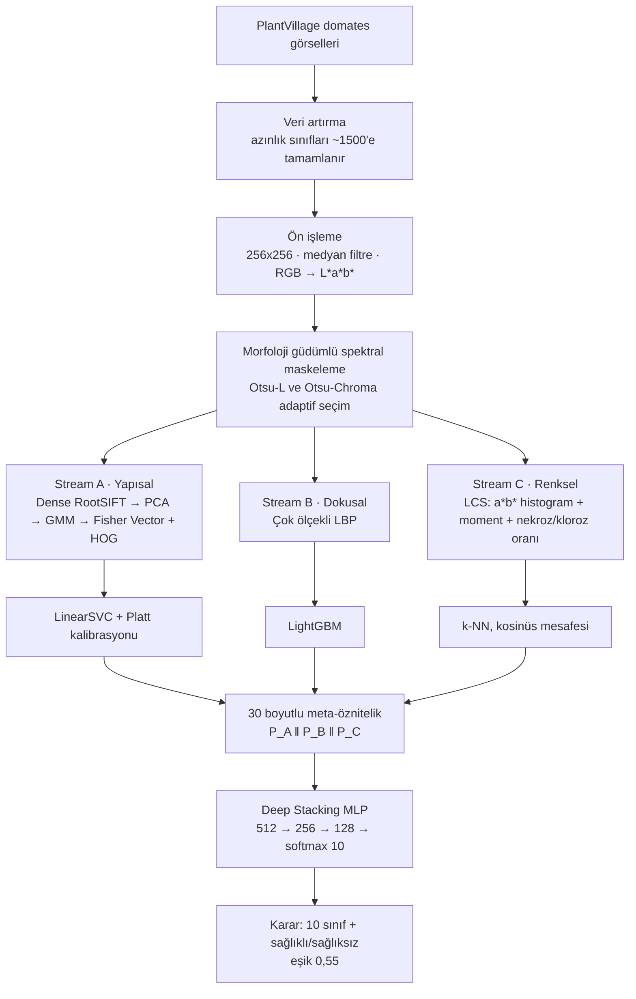
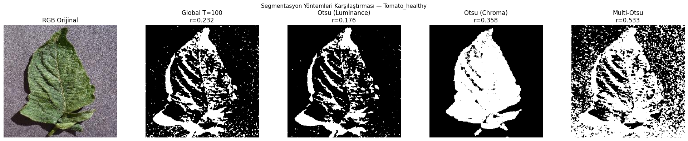
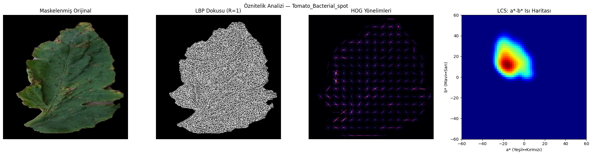
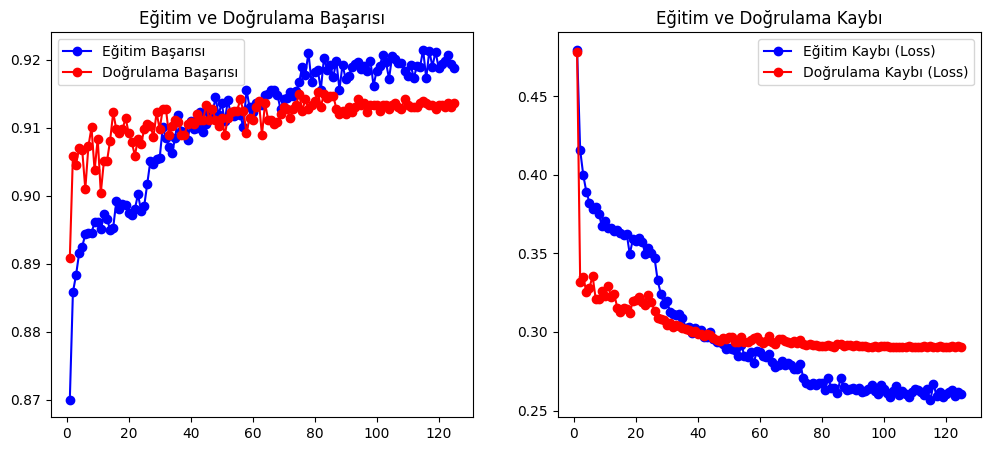
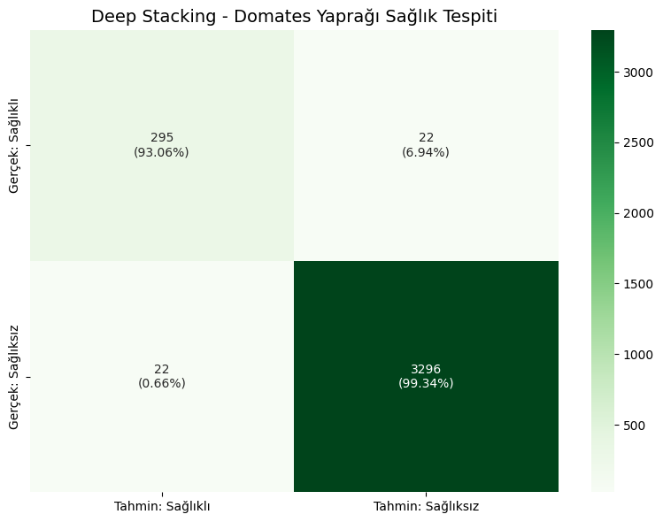
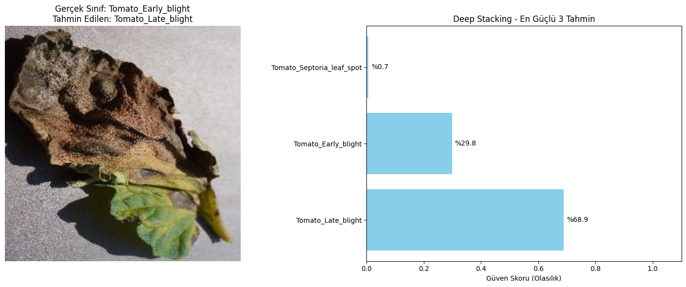
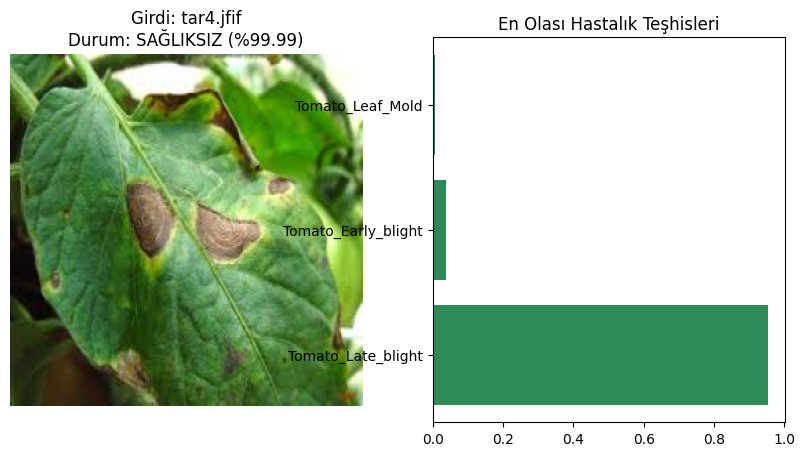

# 🍅 Domates Yaprağı Hastalıklarının Tespiti

**Morfoloji Güdümlü Spektral Maskeleme ve Çok Akışlı Öznitelik Füzyon Mimarisi**

PlantVillage veri setindeki **10 domates yaprağı sınıfını** (9 hastalık + sağlıklı) derin evrişimli ağlar (CNN) kullanmadan sınıflandıran hibrit bir görüntü işleme ve makine öğrenmesi sistemidir. Biyolojik ön bilgi (yeşil/kırmızı-kahverengi/sarı doku renkleri, lezyon dokusu ve şekli) doğrudan öznitelik çıkarımına gömülür; böylece her akışın ne gördüğü yorumlanabilir kalır.

| Gösterge | Değer |
|---|---|
| 10 sınıflı doğruluk (20 % hold-out, 3.635 görsel) | **%91,25** (makro F1: 0,9052) |
| 10 sınıflı doğruluk (5 katlı çapraz doğrulama, ağırlıklı füzyon) | %87,23 (makro F1: 0,8639) |
| Sağlıklı / sağlıksız (ikili) doğruluk | **%98,79** |
| Ortalama çıkarım süresi | ~404 ms / görsel (≈ 2,5 FPS, Google Colab) |

---

## İçindekiler

1. [Sınıflar ve veri seti](#sınıflar-ve-veri-seti)
2. [Yöntem ve işlem akışı](#yöntem-ve-işlem-akışı)
3. [Kullanılan teknolojiler](#kullanılan-teknolojiler)
4. [Kurulum](#kurulum)
5. [Çıktılar ve sonuçlar](#çıktılar-ve-sonuçlar)
6. [Depo yapısı](#depo-yapısı)


---

## Sınıflar ve veri seti

Veri seti: [PlantVillage (Kaggle – `emmarex/plantdisease`)](https://www.kaggle.com/datasets/emmarex/plantdisease). Yalnızca domates klasörleri tutulur (orijinalde 16.011 görsel).

| ID | Sınıf | ID | Sınıf |
|---|---|---|---|
| 0 | Bacterial spot (bakteriyel leke) | 5 | Spider mites (iki noktalı örümcek akarı) |
| 1 | Early blight (erken yanıklık) | 6 | Target spot (hedef leke) |
| 2 | Late blight (geç yanıklık) | 7 | Yellow Leaf Curl Virus (sarı yaprak kıvırcıklığı) |
| 3 | Leaf mold (yaprak küfü) | 8 | Mosaic virus (mozaik virüsü) |
| 4 | Septoria leaf spot | 9 | Healthy (sağlıklı) |

Sınıf dengesizliğini azaltmak için az örnekli sınıflar (Early blight, Leaf mold, Target spot, Mosaic virus) `ImageDataGenerator` ile yaklaşık 1.500 görsele tamamlanmıştır → **18.184 görsel**. Segmentasyon sonrası 9 görsel (yaprak alanı çok büyük) elenmiş, **18.175 görsel** kullanılmıştır.




---

## Yöntem ve işlem akışı



### 1. Ön işleme
- Görseller **256×256** boyutuna getirilir (`INTER_AREA`).
- Gri tonlu kopyaya **3×3 medyan filtre** uygulanır (tuz-biber gürültüsü; lezyon kenarları korunur).
- RGB → **L\*a\*b\*** dönüşümü yapılır: a\* kanalı yeşil↔kırmızı (sağlıklı doku ↔ hastalıklı doku), b\* kanalı mavi↔sarı (sararma) bilgisini taşır.


### 2. Morfoloji güdümlü spektral maskeleme (segmentasyon)
- Dört yöntem karşılaştırılır: global eşik (T=100), Otsu (parlaklık), Otsu (chroma = √(a\*²+b\*²)), Multi-Otsu.
- Nihai yöntem **adaptif**: Otsu-L ve Otsu-Chroma maskeleri ayrı ayrı üretilir; morfolojik **açma (3×3) → kapama (5×5, 2 iterasyon) → delik doldurma → en büyük bağlı bileşen** ile temizlenir.
- Maskelerden yaprak alan oranı geçerli aralıkta (0,10–0,90) olan ve hedef orana (0,38) daha yakın olan kanal seçilir.
- Alan oranı < 0,05 veya > 0,95 olan görseller elenir.




### 3. Üç akışlı öznitelik çıkarımı (yalnızca maskelenmiş yaprak bölgesinden)

| Akış | Öznitelik | Boyut | Ne yakalar? |
|---|---|---|---|
| **A – Yapısal** | Dense **RootSIFT → PCA(64) → GMM(32) → Fisher Vector** + **piramidal HOG** (256 ve 128 px, Hellinger norm.) | 4096 + 9864 = 13.960 | Lezyon şekli, kenar yönelimi |
| **B – Dokusal** | **Çok ölçekli LBP** ((P,R) = (8,1), (16,2), (24,3), uniform) | 54 | Mikro doku, pürüzlülük |
| **C – Renksel** | **LCS (Lesion Color Signature)**: 16×16 a\*b\* histogramı, momentler (ort., std, çarpıklık), nekrotik ve klorotik doku oranı | 264 | Hastalığa özgü renk imzası |



### 4. Uzman sınıflandırıcılar (1. aşama)
- **Stream A → LinearSVC** (C=1) + 5 katlı **Platt (sigmoid) kalibrasyonu** ile olasılık üretimi
- **Stream B → LightGBM** (63 yaprak, 300 ağaç, öğrenme oranı 0,05, `class_weight='balanced'`)
- **Stream C → k-NN** (kosinüs mesafesi, mesafe ağırlıklı; k ∈ {3, 5, 7} her dış katta 3 katlı iç CV ile makro F1'e göre seçilir)
- Tahminler **5 katlı tabakalı çapraz doğrulama** ile *out-of-fold* olarak üretilir.

### 5. Meta-karar katmanı (2. aşama – Deep Stacking)
- Üç akışın 10'ar sınıflı olasılık vektörü birleştirilerek **30 boyutlu meta-öznitelik** oluşturulur.
- **MLP**: Dense(512, Swish, L2=1e-4) + BN + Dropout(0,5) → Dense(256, Swish, L2=1e-4) + BN + Dropout(0,4) → Dense(128, ReLU) + BN → Softmax(10)
- Adam (lr=0,001), en fazla 200 epoch, batch 32, `EarlyStopping(patience=20)` ve `ReduceLROnPlateau(factor=0,2)`.
- Veri %80 / %20 (tabakalı) bölünür; "sağlıklı" sınıfı için **0,55 karar eşiği** uygulanır.

---

## Kullanılan teknolojiler

| Alan | Araçlar |
|---|---|
| Dil / ortam | Python 3, Jupyter Notebook, Google Colab |
| Görüntü işleme | OpenCV (`cv2`), scikit-image (LBP, HOG, Multi-Otsu, renk uzayları), SciPy (`ndimage`) |
| Klasik makine öğrenmesi | scikit-learn (LinearSVC, CalibratedClassifierCV, k-NN, PCA, GaussianMixture, StratifiedKFold), LightGBM |
| Derin öğrenme (yalnızca meta-katman) | TensorFlow / Keras (MLP) |
| Veri / görselleştirme | NumPy, pandas, Matplotlib, seaborn, tqdm |
| Veri kaynağı | Kaggle API (PlantVillage) |

---

## Kurulum

> Proje Google Colab üzerinde geliştirilmiştir. Notebook'taki yollar (`/content/plant_data`, `/content/outputs`) Colab'a göredir.

### Seçenek 1 — Google Colab (en kolay)
1. `tomato_leaf_diseases.ipynb` dosyasını [Google Colab](https://colab.research.google.com/)'a yükleyin (veya GitHub'dan açın).
2. Kaggle hesabınızdan **Settings → API → Create New Token** ile `kaggle.json` indirin ve Colab oturumuna yükleyin.
3. Hücreleri sırayla çalıştırın (ilk hücreler veri setini indirir ve ayıklar).

### Seçenek 2 — Yerel kurulum

```bash
# 1) Depoyu klonlayın
git clone https://github.com/<kullanici-adi>/<repo-adi>.git
cd <repo-adi>

# 2) Sanal ortam oluşturun
python -m venv .venv
source .venv/bin/activate        # Windows: .venv\Scripts\activate

# 3) Bağımlılıkları kurun
pip install -r requirements.txt

# 4) Kaggle API anahtarını yerleştirin (kaggle.json)
mkdir -p ~/.kaggle && cp kaggle.json ~/.kaggle/ && chmod 600 ~/.kaggle/kaggle.json

# 5) Veri setini indirip açın
kaggle datasets download -d emmarex/plantdisease
unzip -q plantdisease.zip -d ./plant_data && rm plantdisease.zip

# 6) Notebook'u açın
jupyter notebook tomato_leaf_diseases.ipynb
```

Yerel çalıştırmada notebook içindeki şu yolları kendi dizininize göre güncelleyin:

```python
DATASET_ROOT = "./plant_data/PlantVillage"
OUTPUT_DIR   = "./outputs"
```

Ayrıca notebook'un son hücrelerindeki `tar.jfif` / `tar4.jfif` örnek görsellerini kendi test görselinizle değiştirin.

**Çalışma sırası:** veri indirme → yalnızca domates klasörlerini tutma → veri artırma → ön işleme ve segmentasyon → maske üretimi (`dataset_contract.npy`) → öznitelik çıkarımı (LBP, HOG, LCS, Fisher Vector) → uzman modeller ve 5 katlı CV → ablation → MLP stacking → değerlendirme ve hız ölçümü.

---

## Çıktılar ve sonuçlar

### Segmentasyon doğrulaması (150 rastgele görsel)
- Ortalama yaprak alan oranı: **0,379 ± 0,105** (ham Otsu-L: 0,372 ± 0,141) — adaptif yöntem varyansı belirgin azaltır.
- Hedef aralıkta [0,20 – 0,70] olan maske oranı: **143 / 150 (%95,3)**
- Tüm veri setinde seçilen kanal: Chroma 11.265, Parlaklık (L) 6.892, fallback 18


### Ablation çalışması (5 katlı CV, ağırlıklı füzyon: 0,4 / 0,3 / 0,3)

| Model | Accuracy | F1-Macro |
|---|---|---|
| Stream A: FV + HOG → LinearSVC (yapısal) | 0,8363 | 0,8246 |
| Stream B: LBP → LightGBM (dokusal) | 0,7186 | 0,7039 |
| Stream C: LCS → k-NN (renksel) | 0,6909 | 0,6782 |
| **Hibrit füzyon (A+B+C)** | **0,8723** | **0,8639** |

En iyi tekil akışa göre füzyon kazancı: **+3,60 puan**. Katlara göre doğruluk: 0,8801 · 0,8704 · 0,8696 · 0,8677 · 0,8737.


### Deep Stacking (MLP) — 10 sınıflı sonuç (hold-out, n = 3.635)

**Accuracy: %91,25 · Makro F1: 0,9052 · Ağırlıklı F1: 0,9121**

| Sınıf | Precision | Recall | F1 | Destek |
|---|---|---|---|---|
| Bacterial spot | 0,9465 | 0,9153 | 0,9306 | 425 |
| Early blight | 0,8598 | 0,7819 | 0,8190 | 298 |
| Late blight | 0,8953 | 0,8976 | 0,8965 | 381 |
| Leaf mold | 0,9126 | 0,9495 | 0,9307 | 297 |
| Septoria leaf spot | 0,8603 | 0,8701 | 0,8652 | 354 |
| Spider mites | 0,8941 | 0,9075 | 0,9007 | 335 |
| Target spot | 0,8339 | 0,8367 | 0,8353 | 300 |
| Yellow Leaf Curl Virus | 0,9652 | 0,9922 | 0,9785 | 642 |
| Mosaic virus | 0,9650 | 0,9650 | 0,9650 | 286 |
| Healthy | 0,9306 | 0,9306 | 0,9306 | 317 |



### Sağlıklı / sağlıksız (ikili) sınıflandırma

| Sınıf | Precision | Recall | F1 | Destek |
|---|---|---|---|---|
| Sağlıklı | 0,9306 | 0,9306 | 0,9306 | 317 |
| Sağlıksız | 0,9934 | 0,9934 | 0,9934 | 3.318 |

**Genel doğruluk: %98,79**




### Örnek tahminler




### Hız / verimlilik
100 görselde ham görüntüden nihai karara kadar ortalama **404,06 ms ± 94,41 ms** (≈ **2,47 FPS**); tek görselde ölçülen süre 0,3455 s.

### Hata analizi
"Sağlıklı" olup yanlış sınıflanan örneklerde hatalar ağırlıklı olarak *Target spot*, *Septoria leaf spot* ve *Spider mites* sınıflarına kaymaktadır; üç akışın kararları tablo halinde notebook'un son hücresinde incelenebilir.

---

## Depo yapısı

```
.
├── tomato_leaf_diseases.ipynb   # Tüm işlem hattı (veri → segmentasyon → öznitelik → model → değerlendirme)
├── requirements.txt             # Python bağımlılıkları
├── images/                      # Notebook çıktılarından alınan şekiller
└── README.md
```

---

